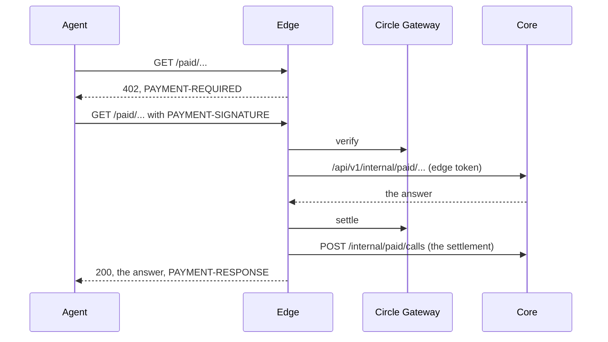

# The paid API

Misthos sells read-only views of what it already knows to agents, one call at a time,
over [x402](https://x402.org). An agent asks, is told the price, signs a USDC
authorisation, asks again, and gets the answer. Nobody signs up, nobody holds an API
key, and the buyer pays no gas. This is Path B in [ARCHITECTURE.md](./ARCHITECTURE.md)
(ADR-2): metered calls, settled through Circle Gateway Nanopayments on Arc. The work
payments for issues stay on Path A, the escrow, and nothing here touches it.

The epic is #200. This page grows with it: each phase adds its routes to the
[catalog](#the-catalog).

## One paid call



1. **Unpaid, the answer is 402.** The `PAYMENT-REQUIRED` header is base64 JSON,
   `x402Version: 2`, naming the resource and every way to pay. The body says the same
   thing for a reader:

   ```json
   {
     "error": "payment_required",
     "route": "decisions",
     "price": { "usdc": "0.01", "base_units": "10000" },
     "accepts": [{
       "scheme": "exact",
       "network": "eip155:5042002",
       "asset": "0x3600000000000000000000000000000000000000",
       "amount": "10000",
       "payTo": "0x<the seller>",
       "maxTimeoutSeconds": 604900,
       "extra": { "name": "GatewayWalletBatched", "version": "1", "verifyingContract": "0x<Gateway Wallet>" }
     }]
   }
   ```

   The asset and the Gateway Wallet come from Gateway's own list of what it supports,
   so they are never typed in by hand.

2. **Verify, then work, then settle.** The edge verifies the signed payment with the
   facilitator, which moves nothing. It then asks the core for the answer. Only if the
   core answered does it settle. A call that fails is never charged, and the buyer may
   retry it with the same signature, because nothing was taken. If settlement fails,
   the answer is withheld: `402 settlement_failed`, `charged: false`.

   Circle's `createGatewayMiddleware` settles before the handler runs, so a handler
   that then fails has already been paid. That is why the edge drives the facilitator
   one step at a time instead.

3. **A paid answer carries `PAYMENT-RESPONSE`**: base64 JSON with the transaction, the
   network and the payer.

4. **The same payment twice gets the first answer.** A payment is its payer and its
   EIP-3009 nonce, not the header's text, so the same authorisation spelled another way
   is the same payment. Within 15 minutes the edge answers it again from memory, marked
   `X-Misthos-Replayed: true`: the work does not run again and the payment is not taken
   again. Two copies arriving at once run once. A payment that already bought a
   different request is refused, `409 payment_already_used`. After 15 minutes Gateway
   itself refuses a spent authorisation.

   **A settlement that goes unheard is retried, not repeated.** If the facilitator
   cannot be heard when the edge settles (a timeout, a reset), Gateway may or may not
   have taken the payment. The answer is kept back, `502 settlement_unconfirmed` with
   `charged: "unknown"`, and the same `PAYMENT-SIGNATURE` sent again settles it again
   without running the work again. If Gateway then says the authorisation was already
   settled, it was: it pays only this seller and only this request holds it, so the
   answer is delivered.

5. **Every settlement is written down.** The edge logs one JSON line,
   `{"event":"x402.settled", route, request, payer, network, amount, asset,
   transaction}`, and posts the same to the core, which keeps the ledger of paid calls
   (`paid_calls`, migration `0019`). See [reconciliation](#reconciliation).

### Long work

A route marked async (the pre-flight review, #204) verifies the payment, queues the
job, and answers `202` with `job_id`, a `receipt` and `poll`. The payment is settled
when the job finishes: the edge checks its unfinished jobs every few seconds, so a
finished review is paid for whether or not its buyer comes back. Polling
`GET {route}/jobs/{job_id}` with `Authorization: Receipt <receipt>` is free: `202`
while the job runs, then `200` with the result and `PAYMENT-RESPONSE`. The result stays
readable with the receipt until the job expires (marked `X-Misthos-Replayed` after the
first read), so a lost answer is not a lost purchase; it is settled once however often
it is read. A job that fails is never settled, and a core that cannot answer a poll
(`503`) does not lose the job.

One wallet may hold three unsettled jobs at once; a fourth is `429 too_many_jobs`, not
charged, before any work runs. The edge holds verified payments in memory for 24 hours,
well inside Gateway's seven-day window, so a restart loses a payment rather than
charging for a result nobody can collect.

## What the rail cannot do

- **`exact` only.** Gateway settles the `exact` scheme and nothing else, so a price is
  fixed when the 402 names it. There is no `upto`: a call whose cost varies is sold at
  a capped price instead.
- **EOA signatures only.** Nanopayments do not accept ERC-1271, so a smart contract
  account cannot buy. The buyer keeps a Gateway balance and signs from an EOA.
- **Testnet.** Arc testnet (`eip155:5042002`) by default. Mainnet is refused unless
  `EDGE_CONFIRM_MAINNET=5042`, and is out of scope for #200.

## The free tier

A route marked free-tier is free, with no payment, to:

- a caller sending `X-Api-Key` with one of `EDGE_FREE_API_KEYS`; or
- a signed-in session (`Authorization: Bearer <session>`) the core says may use that
  route free. The edge asks the core (`POST /api/v1/internal/paid/access`), which looks
  the session up and applies the route's rule in `services/paid.py`. A route without a
  rule is never free to a session, and no session is free without a linked GitHub
  login: every buyer already has a wallet, and signing in with one costs nothing, so a
  wallet alone would make the free tier free to everyone.

Everyone else pays.

## The catalog

`GET /paid` on the edge is the seller page's data, free: the network, the seller, how
to pay, and every route with its id, method, path, price, whether it is free-tier or
async, and an example. `edge/src/catalog.ts` is the allowlist. The edge serves a paid
route only if it is listed there, and anything else under `/paid` is `404
not_a_paid_route`. Nothing wraps `/api/v1/*`.

Every listed route lives under `/paid/`, and its work runs in the core under
`/api/v1/internal/paid/`. The edge refuses at startup a route outside `/paid/`, and
refuses to forward a call whose core path leaves the paid API, however its parameters
are spelled. No paid route reaches an auth, wallet, statement, policy or lifecycle
route; tests in both services walk every route and check.

| Route | Id | Price | Free to | Phase |
| --- | --- | --- | --- | --- |
| `GET /paid/decisions` | `decisions` | $0.02 a page | anyone signed in | #202 |
| `GET /paid/reputation/{contributor_id}` | `reputation` | $0.05 | that contributor | #202 |
| `GET /paid/escrow/{issue_id}/attestation` | `escrow-attestation` | $0.02 | that issue's publisher | #202 |
| `POST /paid/price` | `price` | $0.25 | any publisher | #203 |
| `GET /paid/comparables` | `comparables` | $0.10 | any publisher | #203 |
| `POST /paid/review` | `review` | $2.00, the cap | nobody | #204 |
| `GET /paid/opportunities` | `opportunities` | $0.02 a page | anyone signed in | #206 |
| `GET /paid/receipt/{settlement_id}` | `receipt` | $0.01 | that issue's contributor and publisher | #206 |
| `POST /paid/screen` | `screen` | $0.25 | nobody; off by default | #206 |

`/paid/pricing-report`, which charged $0.25 for the free `/api/v1/metrics`, is gone, and
no market report replaces it: the metrics stay free.

A call the core cannot answer is answered with `{"error", "detail", "charged": false}`
and the payment is not taken: `400` for a filter or parameter the route does not know
(an unknown filter is refused, never ignored), `404` for a record that does not exist,
`409` when the record and the chain disagree, `502` when the chain cannot be read, and
`503` when a signing key is not configured.

### Views over what the platform holds (#202)

Raw public reads stay free: `GET /api/v1/decisions` (the newest 500), a contributor's
profile, `GET /api/v1/issues/{id}/escrow`. What these sell is what those do not give.

**`GET /paid/decisions`**: the whole append-only decision log, oldest first, in
`(created_at, id)` order. `limit` is 1 to **200**, the maximum page size, and 50 by
default. Each page is one payment, and `next` is the cursor for the following page,
`null` on the last. Filters: `issue_id`, `actor` (`agent`, `publisher`, `contributor`,
`system`), `action`, `since` and `until` (ISO 8601; a time with no zone is UTC; `since`
is inclusive, `until` exclusive). Decisions name contributors by handle, never by
wallet, as the public log does.

**`GET /paid/reputation/{contributor_id}`**: a contributor's standing taken apart, as
aggregates only. `reputation`, `settled_issues` and `earned` are exactly the standing
the money ledger derives (`services/reputation.py`). On top of them:

- `score`, 0 to 100: `100 * points / (points + 50)`. A record of about five settled
  issues scores 50, and the curve saturates, so a long record counts for more than one
  large issue.
- `percentile`: the share of contributors with any standing whose points are at or
  below this one's, out of `ranked_contributors`; `null` with no standing.
- `signals`: the agent's verdicts on work the contributor holds (accept, rework,
  reject), `acceptance_rate`, `rework_rounds`, `first_pass_settled` (settled with no
  rework), and disputes opened, overturned and upheld. Counted from the contributor's
  own claim on, so an issue that changed hands is not the earlier claimant's record.
- `repos` and `labels`: where the contributor settled work, most first.

No wallet, no handle, and no payout transfer is in the answer.

**`GET /paid/escrow/{issue_id}/attestation`**: a signed certificate of what
`MisthosEscrow` holds for an issue. The core reads the commitment from the chain,
compares it with its own record of the commitment (amount, status, publisher, deadline),
and signs only when they agree; a divergence is `409 escrow_diverges` and is not
charged. The certificate names the issue and its `bytes32` key, the publisher and its
wallet, the amount and take rate, the deadline, the status (`held`, `released`,
`refunded`), the contract, chain and commitment transaction, and when it was read.

```json
{
  "certificate": { "kind": "misthos/escrow-attestation", "version": 1, "issue": { "id": "ISS-1001", "key": "0x…" }, "amount": { "usdc": "762.05", "base_units": 762047999 }, "status": "held", "escrow": { "contract": "0x…", "chain_id": 5042002, "network": "eip155:5042002", "commit_tx": "0x…" }, "read_at": "…" },
  "canonical": "{\"amount\":…}",
  "signature": "0x…",
  "signer": "0x…",
  "scheme": "eip191-personal-sign"
}
```

To check one: recover the signer from `canonical` and `signature` with EIP-191
`personal_sign` (in Python, `Account.recover_message(encode_defunct(text=canonical),
signature=signature)`), compare it with `certificate_signer` on `GET /paid`, and read
the commitment from `escrow.contract` on `escrow.chain_id` by `issue.key` to see it
still holds. `canonical` is the certificate with sorted keys and no whitespace, and it
is the text that was signed.

The certificate key is a third key, kept in the secret store by
`MISTHOS_CERTIFICATE_SECRET_REF` like the escrow's two. The escrow does not know it, so
nothing it signs can move money. Without it the attestation is `503` and not charged.

### Pricing and the history behind it (#203)

**`POST /paid/price`**: what the engine suggests for an issue the caller describes. It
runs exactly what the issue page runs (`Store.price_advice`: read the signals, find the
comparables, propose), on the caller's description, and lists nothing.

```json
{
  "title": "Retry webhook deliveries that time out",
  "body": "Deliveries that time out are dropped. Expected: retried with backoff.",
  "repo": "acme/hooks",
  "labels": ["bug"],
  "signals": { "blast_radius": 4 },
  "compliance_driven": false,
  "prior_attempts": 0
}
```

`title` and `repo` (`owner/name`, or a `github.com` link) are required. `signals` sets
any of the six (`code_surface`, `requirement_clarity`, `test_coverage`,
`dependency_depth`, `prior_attempts`, `blast_radius`, each 1 to 5) over what the
engine reads from the text; anything else in the body, an unknown signal, or one out
of range is `400`. The repository is not fetched, so a signal that would be judged
from its file tree is judged from the text alone; set it if you know better.

The answer: `recommended`, `band.low` and `band.high`, `confidence` (`low`, `medium`,
`high`) and `confidence_reason`, which says plainly when the history is thin or
missing, `complexity_score`, `estimated_hours`, each signal with its score, whether it
was read or given, and why, `comparables_used` and up to 25 `comparables` (each with
its price, settled date, repo, distance and the price it implies), and the
`justification`. It is advice: on Misthos the publisher names the price, and nothing
here bounds it. No publisher's budget, policy or wallet is in it.

Every quote is kept with what was asked (`price_quotes`, migration `0020`), for audit
and for calibrating the engine. It carries the edge's request digest
(`X-Misthos-Request-Digest`), the same one its settlement carries, so a quote joins the
payment that bought it.

**`GET /paid/comparables`**: the settled history the engine compares against.
Filters: `repo`, `labels` (comma separated; a settlement must carry them all), and the
six signals, all of them or none. With signals, the list is the engine's own
comparables for work of that shape (settled within a year, close enough to count,
closest first with same-repository work ahead), each with its distance and implied
price. Without, it is every settlement, newest first. `limit` is 1 to **100**, 20 by
default; follow `next`. An unknown filter, or some signals but not all, is `400`.

### A pre-flight review (#204)

**`POST /paid/review`**: the review agent holds a diff to acceptance criteria, before
anything is submitted. It is the reviewer and the rules the lifecycle review uses
(`store.reviewer`, then `domain/review.decide`, with no rework rounds behind it), so a
diff that passes here passes there on the same criteria. It is not that review:
nothing reads or writes an issue, posts to GitHub, publishes a verdict or moves money,
and the signed-in, per-issue review is unchanged.

```json
{
  "criteria": ["Covered by a test", "Documented in the changelog"],
  "diff": "diff --git a/tests/test_x.py b/tests/test_x.py\n…",
  "title": "Retry timed-out deliveries",
  "repo": "acme/hooks",
  "checks_passed": true
}
```

`criteria` is 1 to 20, each up to 500 characters. Send a unified diff (`git diff` or
plain, up to 200,000 characters and 300 files) or `pull_request: {repo, number}`, which
the core reads through the GitHub App, with the checks on its head commit. Only a public
repository's pull request is read: a private one is answered exactly as a missing one,
`404 pull_request_unreadable`, so the App's access to it is neither used nor revealed,
and no job is made.

The review is a job ([long work](#long-work)). Paid, the answer is `202` with `job_id`,
`receipt` and `poll`. Poll `GET /paid/review/jobs/{job_id}` with
`Authorization: Receipt <receipt>`, free: `202` while it is queued or running, then
`200` with the result and `PAYMENT-RESPONSE`, settled once when it finished. The result: `verdict` (`accept`,
`rework`, `reject`), the `rule` that produced it, `findings`, and for each criterion
`met` (`true`, `false`, or `null` when it was not judged) with its `evidence`, the
reviewer's `summary`, and how long it took. A review that fails, or does not finish
within 15 minutes, is `failed` and never charged.

**`upto` is not available.** #204 asked for the `upto` scheme with a cap so the charge
could follow token use. Circle Gateway settles `exact` only, so the review is sold at
the cap, $2.00, and the size limits above keep the work inside what it pays for. The
402 says so: `scheme: "exact"`, `cap`, `upto: false`, and a note.

Each review is kept as a job row and then as a calibration record (`paid_reviews`,
migration `0021`): latency, cost, verdict, reviewer, and the diff's size, never the
diff.

### Deal flow and receipts (#206)

**`GET /paid/opportunities`**: funded issues still open, the feed a contributor's agent
works from. Only issues whose money the escrow holds and whose work is not yet accepted
(`FUNDED`, `CLAIMED`, `IN_REVIEW`, `REWORK`). Each names its price, what the
contributor would receive after the fee, the deadline, whether it can be claimed now
and when a claim on it runs out, the repo, labels, acceptance criteria and its GitHub
link; never who holds it. Filters: `repo`, `labels` (comma separated, all of them),
`min_price` and `max_price` (USDC), `claimable` (`true`, `false`), `sort` (`newest`,
the default, `price` or `deadline`). `limit` is 1 to **100**, 25 by default; follow
`next`. The web app's issue list stays free.

**`GET /paid/receipt/{settlement_id}`**: a signed receipt of one issue's settlement.
The settlement id is the issue's id; an issue settles once, released to its
contributor or refunded to its publisher. The core checks the money ledger (one
commitment and one settlement of the committed amount), the record (fee and payout
add up to the commitment) and the escrow (released or refunded, for that amount)
before it signs, and a disagreement is `409 ledger_diverges`, not charged. The receipt
names the outcome, gross, fee and rate, net, who was paid, when, and the escrow and
commitment transaction, signed like an attestation with the certificate key.

The release transfer names the contributor's wallet on chain, so `settlement_tx` is in
the contributor's own receipt only, read free with their session. Everyone else's
receipt, the publisher's included, carries `null` there: next to an issue whose
contributor is public, the transfer would link a wallet to a person. The chain is
public, so a reader with the escrow's events and this receipt's issue key could still
find the release there; the receipt does not hand it over. A refund's transfer goes to
the publisher's wallet, which the escrow already shows, so a refund's receipt carries
it.

**`POST /paid/screen`**: a sanctions-list check of one wallet, `{"address": "0x…"}` to
`clear` or `hit` and the list. **Off.** Reselling a screening provider's answers needs
its terms and a legal review, so until `EDGE_PAID_SCREENING=true` on the edge and
`MISTHOS_PAID_SCREENING_ENABLED=true` on the core, it answers `503
route_unavailable` before any price is named, and nobody signs a payment for it.

## Distribution (#205)

- **The API page.** The web app's `API` link (`/public-api`, #208) lists every route a
  stranger may call, the free ones from `openapi.json` (`x-misthos-public`) and the x402
  ones from this catalog, read through `GET /api/v1/catalog/paid`, with the price as a
  column. Each paid route's `name`, `summary`, `group` and `returns` in `catalog.ts` are
  what the page shows.
- **The seller page.** `GET /paid` on the edge answers HTML to a browser and JSON to an
  agent, from the same catalog, so the page cannot disagree with what is charged: every
  route, its price, the network and asset, the seller's address, the certificate signer,
  and a call that works.
- **The MCP server.** [mcp/](../mcp/README.md) offers one tool per paid route, reads the
  prices from `GET /paid`, does the 402 handshake from the agent's own Gateway balance,
  and keeps every call inside a spend cap and a per-call cap. A review's price is held
  until it is collected, then counted once.
- **Buyers.** [BUYING.md](./BUYING.md): an EOA, the faucet, a Gateway deposit, a call.
- **Listings.** [LISTING.md](./LISTING.md) has the copy for Circle's Agent Marketplace
  and an x402 directory, and the checks to run before listing. Listing itself is done
  by whoever holds those accounts.

Every error the edge gives is JSON, `{"error": "<code>", …, "charged": false}`: a body
that is not JSON is `400 bad_json`, a path that is not here `404 not_found`, and a bug
`500 internal_error`, with no stack, path or internal address in any of them.

## The core's side

The core's paid routes are internal: every request must carry `X-Misthos-Core-Token`
equal to `MISTHOS_EDGE_CORE_TOKEN`, and anything else is answered `404`, as if nothing
were there. They are not in the API schema. The edge tells the core who a call is for
in `X-Misthos-Paid-Route`, `X-Misthos-Payer`, and `X-Misthos-Free-Caller`
(`role:party_id` or `api-key`).

The core's address never reaches a buyer: `/health` does not name it, and an
unreachable core is `502 core_unavailable` with nothing else.

## Reconciliation

Circle Gateway is the authority on what was paid, as the chain is for the escrow.
`GET /api/v1/internal/paid/calls` (edge token; `since`, `route`, `limit` up to 5000)
returns the settled calls, newest first, the total per route and network, and the
grand total. Compare the total with what Gateway credited the seller over the same
period. A settlement the books lack shows up as an `x402.settled` log line with no row,
and the edge logs `x402.unrecorded` when the core refused to record one.

## Configuration

On the edge (`edge/.env.example`):

| Variable | What it is |
| --- | --- |
| `MISTHOS_SELLER_ADDRESS` | The EVM address paid. Required |
| `GATEWAY_FACILITATOR_URL` | Defaults to the testnet facilitator; the SDK's own default is mainnet |
| `GATEWAY_NETWORKS` | CAIP-2 networks accepted, comma separated. Arc testnet by default |
| `EDGE_CORE_TOKEN` | Shared with the core's `MISTHOS_EDGE_CORE_TOKEN`. Required once any paid route is listed |
| `EDGE_PRICES` | JSON of route id to USDC price, overriding the catalog, such as `{"decisions":"0.02"}`. An unknown id or a price that is not a positive USDC amount stops the edge starting |
| `EDGE_FREE_API_KEYS` | Comma separated, each at least 16 characters |
| `EDGE_PAID_SCREENING` | `true` lists the sanctions screen. Off by default (#206) |

On the core, `MISTHOS_EDGE_CORE_TOKEN`; without it every internal paid route is `404`.
And `MISTHOS_CERTIFICATE_SECRET_REF`, the certificate key's name in the secret store;
without it the signed routes are `503`. `MISTHOS_PAID_SCREENING_ENABLED` is the
screen's switch on the core, off by default.
