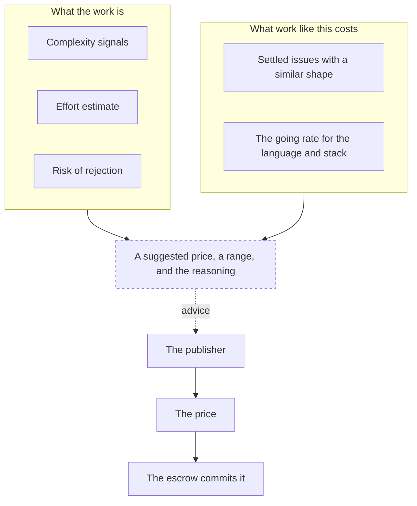

# The fee, and what the engine is for

There are two pricing questions and they are easy to confuse.

The first is what the platform charges. It is one number, and it takes a paragraph.

The second is what the pricing engine does now. It used to decide the price. It does not
any more, and the reason is the most interesting thing in this document.

## The fee

**Ten percent of the committed amount, taken when the work settles, and refunded in full
if it never does.**

| The publisher commits | The contributor receives | The platform keeps |
| --- | --- | --- |
| $50 | $45.00 | $5.00 |
| $500 | $450.00 | $50.00 |
| $5,000 | $4,500.00 | $500.00 |

The publisher pays the price and nothing else, so the number a manager approves is the
number on the issue. The escrow carves the fee out on acceptance
(`MisthosEscrow.release`), paying the contributor the remainder and the platform's wallet
the fee in the same call, so the rate is a transfer rather than a reporting-layer number.
The contract bounds it at 15 percent (`MAX_FEE_BPS`).

**One rate for everyone.** It used to move with a subscription tier, and that was a second
price for the same service. It had a second effect nobody wanted: because the published
price floor was derived from the take rate, a publisher's plan decided the lowest price
they were allowed to pay. The fee does not get cheaper because a company bought a
subscription, so there is no subscription and no plan-dependent rate: the platform takes
a flat 10 percent on settlement.

### What a settled issue earns, and where it does not

Review costs the platform about **$6.31** an issue: agent inference, settlement and
amortised screening. It is not a line on the publisher's invoice, so it comes out of the
fee.

| Price | Fee | Review cost | The platform's result |
| --- | --- | --- | --- |
| $20 | $2.00 | $6.31 | -$4.31 |
| $50 | $5.00 | $6.31 | -$1.31 |
| $63 | $6.30 | $6.31 | $0.00 |
| $100 | $10.00 | $6.31 | +$3.69 |
| $5,000 | $500.00 | $6.31 | +$493.69 |

Break-even is a **$63** price. **Below it the platform loses money, and that is
deliberate.** A settled $50 fix costs $1.31 and buys the transaction, the publisher, the
public payout record and one more row of settled-price history. Refusing that work to
protect $1.31 was the original sin of the previous model. The lever for abuse is a
per-publisher allowance, applied when there is evidence for it and not before.

### The only two bounds

A price must be between **$5 and $100,000**. Outside that it is refused with the bounds,
and that is the whole of it.

The minimum is there to catch a typo and to damp spam. It is **not** derived from the
platform's costs, which is what the old floor was and why it read as arbitrary: it was the
one price at which a 12 percent fee happened to equal a flat $6.31 bill, rounded up to the
next $5. That number said nothing about the work. It only said when the platform stopped
being out of pocket, and it governed the publisher's price anyway.

## The publisher names the price

This is the rule the rest of the product follows.

The buyer types a number. Nothing re-prices it. The escrow commits it. The contributor is
paid it, less the fee, when the pull request merges; if nobody claims the issue by its
deadline the money goes back.

The publisher may change the number themselves while the issue is unfunded and unclaimed,
and no further. Once the money is committed it is what the escrow holds, and once a
contributor holds a claim it is what they are working for. A price that could move under
either of them would be a promise someone can break.

### Why, given that the whole product was built on pricing

Because the buyer is the only party who knows what the work is worth to them, and the
platform is the only party with nothing at stake. A system where the engine proposes and
the publisher may move the number only inside a window the engine chose is a system where
the engine sets the price and the human nudges it. That is what was in the code.

The cost of getting it wrong was not an argument on a forum. It was a refused transaction.
A publisher who knew a fix was worth $200 to them, and was told the floor was $910, did not
raise their number to $910. They left.

### The second reason, which matters more

Every approval used to be the engine's own recommendation echoed back: the field arrived
pre-filled with it, the default was to take it, and the seed data replayed it. So the
**settled-price dataset** that [07](./07-business-model-and-economics.md) names as the
unfair advantage recorded nothing but the engine's opinion of itself. The platform could
not learn what work costs while it was the only party naming the price.

That is now measurable. The metric is the **label rate**: the share of published issues
where the buyer's price differs from what the engine suggested. If that stays near zero,
the platform is still recording its own opinion and has learned nothing, however good the
copy on the page is.

## What the engine does now

It reads the issue and says what it thinks, in a form the publisher can check. It is advice
on the page and it never bounds anything.

### The inputs

| Signal | What raises the score | Weight |
| --- | --- | --- |
| Code surface | The change touches many files, or crosses module or package boundaries | 25% |
| Requirement clarity | The issue leaves the expected behaviour ambiguous, or there is no reproduction | 20% |
| Test coverage | No test exists, or the acceptance test has to be written as well as the fix | 15% |
| Dependency depth | The change interacts with a framework, a database, or a protocol | 15% |
| Prior attempts | Earlier pull requests were opened and abandoned or rejected | 15% |
| Blast radius | A security path, a breaking change, or a public interface | 10% |

The six signals produce an effort estimate in hours, and the hours produce a suggested
price. Settled issues of a similar shape then move that suggestion toward what comparable
work actually paid, and they alone set the confidence. Nothing is declared by a caller: an
issue with no history behind it is priced on its signals alone and says so.

### The output

Not a number on its own. A short brief:

- The suggested price, with the range around it.
- Where the effort estimate came from, in plain language.
- The two or three comparable issues that settled recently, with their prices.
- A confidence level, low, medium or high, based on how much comparable history exists.
- A one-paragraph justification, which is the part a publisher can forward to whoever
  approves budgets.

That last item is the feature with the outsized effect. The buyer's hardest step is not
knowing the price; it is getting the price approved.

### What it is not good at

The suggestion is a bottom-up cost model: score the work, multiply by hours, multiply by a
rate. That method has the worst track record in the field, and ours is no exception. The
repository carries the measurement (`services/calibration.py`, `calibration-report.json`,
#41): thirty GitHub issues that carried a real paid bounty of known worth, from sixteen
organisations.

| | Rate | Worth inside the suggested range | Median error |
| --- | --- | --- | --- |
| The engine as it stands | $90/h | 3.3% | 1,599% |
| The fit to those bounties | $8.09/h | 46.7% | 52% |

The paid bounties have a median of $100, from $15 to $2,000; the engine's suggestion for
the same issues has a median of $1,667. Two things follow, and both are load-bearing for
the decision above.

**The weights were not fitted to that corpus, deliberately.** The fit is degenerate: it puts
70 percent of the weight on blast radius, but twenty-seven of the thirty issues carry the
same blast-radius score because almost none of them is labelled, so a weight on a signal
that barely varies is fitting the rate rather than the signal. And a bounty is a different
market: a price posted to many competing hunters, often as marketing, a third of it below
the floor at which the platform's own review pays for itself.

**The absolute level is untested against professional work.** That is the honest
conclusion, and it is why the suggestion is not allowed to refuse anything. A number whose
error is measured in hundreds of percent, in the region it has never seen a transaction, is
in no position to be a boundary. It is in an excellent position to be a starting point.

### Why it lands high, in three lines

Nothing in the rules names $1,000, and yet that is where an ordinary issue lands. Three
things do it:

1. **The score is a weighted average of six signals**, so it cannot be extreme. To score
   1.0 every signal must sit at its floor. Real readings cluster between 1.7 and 3.3,
   which is already the middle of the range by construction. Averaging is the right way to
   combine signals and the wrong way to produce a price.
2. **The hours map stretches that bounded score by 6.5.** `2 + (score - 1) × 6.5` turns a
   1-to-5 mean into 2 to 28 hours, so a small change in the score moves the estimate by a
   quarter.
3. **One flat hourly rate, $90, applied to everyone**, when the supply it is priced for
   spans a factor of four: from about $25 an hour in South and South-East Asia to about $95
   in North America.

Eleven hours at $90 is about $1,000. That is the arithmetic, and it is why the suggestion
is labelled a suggestion.

## What changed, and what it cost

| Removed | Why |
| --- | --- |
| The published price floor ($55/$65/$80) | A break-even solve dressed as a business rule. Every floor landed within 29 cents of zero margin, and the cheapest plan got the highest floor. Nine of the thirty known prices in the calibration corpus would have been refused. |
| The affordability ceiling | It could only ever lower a price and never raise one, so the buyer's own budget was a one-way constraint on the buyer's own decision. |
| Take rates that moved with a plan (12/10/8) | A second price for the same service, and the reason the floor moved with what a publisher bought. |
| The band as a validation window | A range is advice. Enforcing it is what made the engine the price-setter. |
| The compliance multiplier, and the risk and urgency premiums | Premiums applied as coefficients rather than earned, and the buyer cannot check a coefficient. |
| The automatic re-list uplift | Raising a price on the publisher's behalf is guessing at their budget. They can move the number themselves, and they can publish the issue again after a refund. |

| Kept | Why |
| --- | --- |
| The escrow contract and USDC settlement | This is the product. It works, it is tested, and it costs about a cent. |
| The agent review and the acceptance criteria | The verification is what the 10 percent pays for. Without it this is a payment link. |
| The comparables, the signals and the suggestion | It is the one part of the engine that gets better with every settlement, and it costs the publisher nothing to ignore. |
| First claim wins, with a time-boxed claim | It needs no bidding machinery, and the price is already public. |

## Assumptions that need validating

1. **A $6.31 review cost holds at small issue sizes**, where the diff is small and the
   criteria are short. Confidence: medium. It came from a published agent minute rate, not
   from our own measurements. Test by measuring agent spend per review by issue size.
2. **Buyers who name their own price name a sensible one.** They may name $1 and expect a
   fix. Confidence: medium. The mitigation is showing comparable settled prices on the
   page, which is the whole reason the suggestion exists.
3. **A permissive price does not collapse the median below the point where supply stops
   answering.** Confidence: low. Test by watching time to first claim against price.
4. **Review can be done for roughly six dollars of agent time** at the depth the criteria
   require. Confidence: medium, and the same measurement as the first assumption.
5. **The suggestion earns its place on the page** rather than being decoration a publisher
   scrolls past. Confidence: low. Test with the label rate above, which is what it is for.
